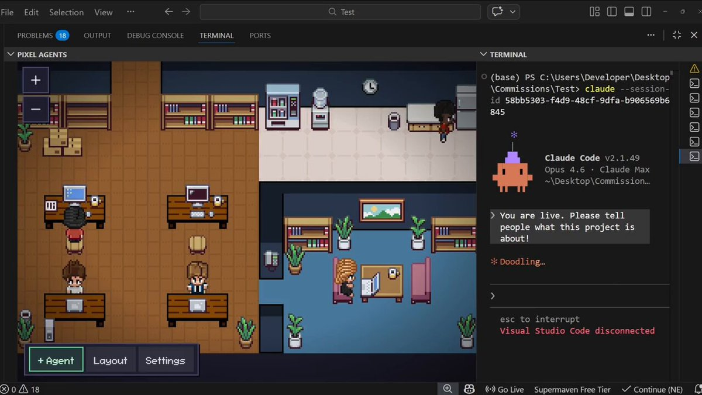
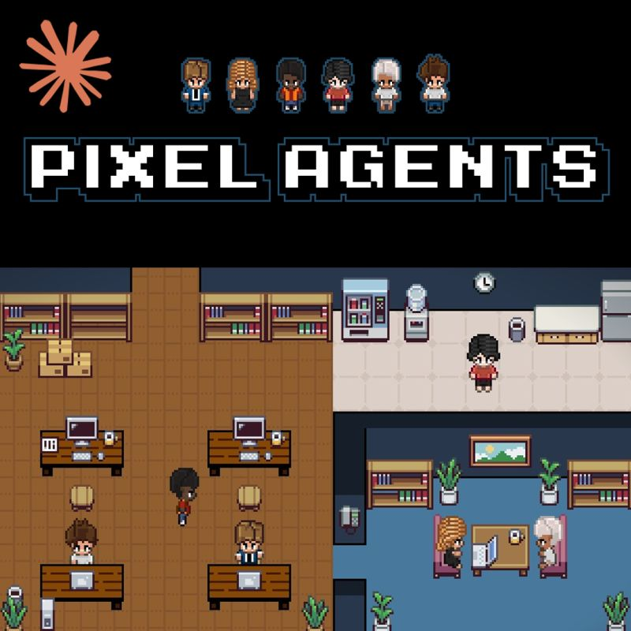

# Pixel Agents Live Coding Activity in Virtual Offices

Pixel Agent HQ is the primary search phrase used here for the Pixel Agents project.
Pixel Agents office views turn supported coding sessions into characters whose activity can be followed at a glance.
The Pixel Agent HQ virtual office and Pixel Agent HQ extension workflows share the same project and session model.

[](https://pixel-agent-hq.github.io/Pixel-Agents/)

## About

Pixel Agents presents coding-agent activity as an animated office rather than a collection of terminal windows.
Use the scene to notice activity and waiting states, then inspect the underlying session when a decision needs context.

The supplied files belong to Pixel Agents itself.
They include VS Code adapters, a standalone server, session tracking, and persistence components.

## Features

| Capability | Office behavior | Useful follow-up |
| --- | --- | --- |
| Live session tracking | Characters reflect observed agent activity | Inspect the associated terminal for details |
| Waiting indicators | Visual cues draw attention to interrupted work | Read the actual permission or input request |
| Multiple sessions | Separate characters represent concurrent work | Check which workspace each session belongs to |
| Sub-agent tracking | Related activity appears alongside the parent | Distinguish the main session from delegated work |
| Office customization | Layouts organize the visible workspace | Keep frequently monitored areas easy to identify |
| Persistent preferences | Supported settings survive later sessions | Verify which host or namespace owns a setting |

A character animation summarizes observed events.
It does not certify that a task succeeded, a test passed, or a requested file was produced.



## Requirements

- A supported coding-agent integration; Claude Code is the reference implementation documented by the project.
- VS Code 1.105.0 or newer for the extension workflow.
- Node.js 20 or newer for the standalone CLI.
- Windows, Linux, or macOS.

Check the release documentation before assuming another provider has the same integration coverage.
An architectural integration interface is not a guarantee that every coding tool is already supported.

## Run Modes

**VS Code extension**

The extension places the office beside your editor and terminals.
Use it when you want to keep session monitoring in the same window as the project.

The [extension.ts](adapters/vscode/extension.ts) entry point registers the office view and initializes its adapter.
The [PixelAgentsViewProvider.ts](adapters/vscode/PixelAgentsViewProvider.ts) component connects the panel with assets and agent runtime behavior.
The [vscodeTerminalAdapter.ts](adapters/vscode/vscodeTerminalAdapter.ts) file wraps VS Code terminal access.

This JSON example uses settings declared by the supplied extension package.
It opens the panel automatically while leaving automatic agent creation disabled.
Merge the properties into your VS Code user or workspace settings as appropriate.

```json
{
  "pixel-agents.autoShowPanel": true,
  "pixel-agents.autoSpawnAgent": false
}
```

These editor settings are separate from office preferences stored by the application.
They do not configure the coding model or replace the coding agent's own settings.

**Standalone CLI**

The standalone host serves the office in a browser and prints its local address.
Run it from the project directory whose sessions you intend to observe.

This terminal example checks Node.js, displays CLI help, and starts the office on a chosen local port.
If that port is already in use, choose another port or omit the port option.

```bash
node --version
npx pixel-agents --help
npx pixel-agents --host 127.0.0.1 --port 4317
```

The [cli.ts](server/src/cli.ts) file implements standalone argument parsing and startup.
The current CLI also offers `--no-terminal` for a watch-only browser experience.
Use the printed address rather than assuming every launch selects the same port.

## How It Works

Pixel Agents combines session observations with state updates sent to its connected office view.
The supplied watcher supports hook-driven lifecycle events and transcript-based activity observation.

### Event Mapping

| Observed signal | What the office can communicate | What to inspect when unclear |
| --- | --- | --- |
| Tool activity | Reading, writing, or other active work | The tool call and its result |
| Permission request | A session needs attention | The original permission prompt |
| Session stop or idle transition | Work has paused or a turn has ended | The agent's final response and produced output |
| Child-session activity | A related worker is active | The parent session and child transcript |

The [transcriptParser.ts](server/src/transcriptParser.ts) component interprets transcript activity.
The [fileWatcher.ts](server/src/fileWatcher.ts) file coordinates discovery and observation.
The [hookEventHandler.ts](server/src/hookEventHandler.ts) component dispatches normalized hook events.

Hooks and transcript observations complement each other.
If an indicator looks stale, inspect the session before concluding that the agent is blocked.

### Architecture

The [sessionRouter.ts](server/src/sessionRouter.ts) component maps sessions to agents and buffers early events.
The [agentStateStore.ts](server/src/agentStateStore.ts) component stores agent state and broadcasts updates.
The [clientMessageHandler.ts](server/src/clientMessageHandler.ts) component handles requests from connected office clients.

Session identity matters when several terminals work in similar folders.
Check the associated project and terminal before replying to an agent or interpreting its status.

**Related workers**

The [subagentWatch.ts](server/src/subagentWatch.ts) component observes background sub-agent transcripts.
It forwards activity to the main store so the view can reflect work related to a parent session.

Do not count every temporary character as a separate long-lived project.
Use parent-child relationships to understand which session owns the work.

## Customizing the Office

Arrange the office so that the sessions you care about remain easy to recognize.
Prefer a readable layout before adding decorative complexity.

- Keep active desks visible.
- Use project areas when the installed release supports them.
- Preserve labels that help distinguish similar sessions.
- Test sound notifications with a small amount of activity.
- Reopen the office to confirm that the layout was saved.

The [layoutPersistence.ts](server/src/layoutPersistence.ts) component reads and writes the saved layout.
The [configPersistence.ts](server/src/configPersistence.ts) component stores application preferences and provider consent state.



### Office assets

Use character appearance as a recognition aid when several sessions are active.
The [paletteAssigner.ts](server/src/paletteAssigner.ts) component assigns palettes and hue shifts consistently across clients.

Asset packs and layout files have their own compatibility and licensing requirements.
Follow the project's asset documentation when importing artwork instead of assuming an arbitrary sprite sheet will work.

## Security

The office host and the underlying coding agent have different responsibilities.
Local activity tracking does not change where the coding provider sends requests or how that provider handles data.

The [claudeHookInstaller.ts](server/src/providers/hook/claude/claudeHookInstaller.ts) component manages integration with Claude hook settings.
The [wsAuth.ts](server/src/wsAuth.ts) component checks tokens, host names, and origins for server connections.

Review a hook-consent prompt before enabling that integration.
Use the actual coding-agent prompt when deciding whether to allow a requested operation.

## Troubleshooting

Begin with one supported session and confirm that its terminal is active.
Then check whether the office is observing the intended directory and whether the integration has been enabled.

- Missing character: confirm the session and workspace being monitored.
- Stale animation: compare the visible status with recent terminal activity.
- Browser connection failure: use the address printed by the current CLI process.
- Unexpected port conflict: select another port or use automatic port selection.
- Missing layout changes: confirm which host and saved state you reopened.

When reporting a problem, include the host mode, operating system, application version, and a short reproduction.
Describe whether it affects one session or every session without publishing private transcript contents.

## Related Documentation

- [Official project README](https://github.com/pixel-agents-hq/pixel-agents/blob/main/README.md)
- [VS Code Marketplace](https://marketplace.visualstudio.com/items?itemName=pablodelucca.pixel-agents)
- [Standalone npm package](https://www.npmjs.com/package/pixel-agents)
- [Project discussions](https://github.com/pixel-agents-hq/pixel-agents/discussions)

## Related Search Terms

Pixel Agent HQ, Pixel Agents, Pixel Agents office, Pixel Agent HQ virtual office, Pixel Agent HQ extension, pixel-art, agents, multi-agent, ai-assistant, dashboard, agent-collaboration, agentic-workflow, vscode, typescript, visualization
